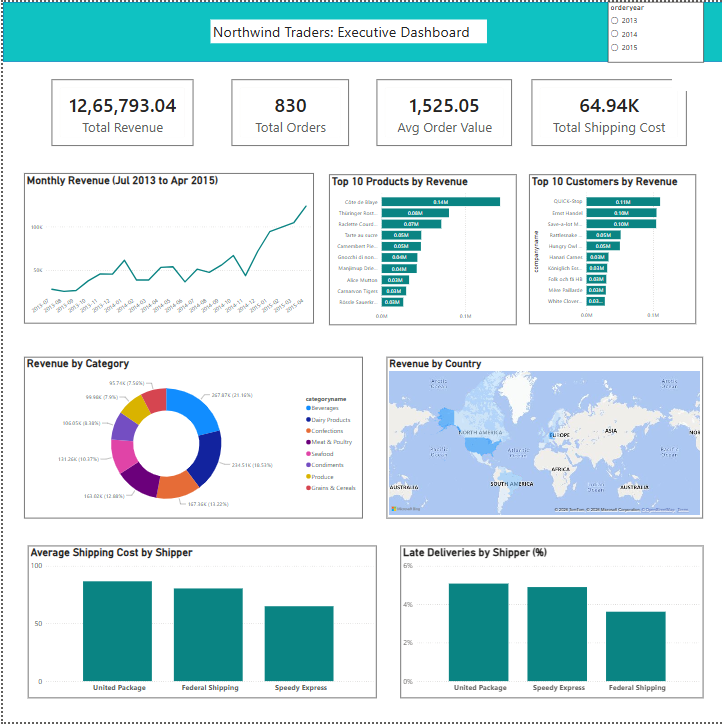

# Northwind Traders: Sales and Shipping KPI Dashboard

An end-to-end analytics project for the Maven Northwind Challenge. I cleaned the data in Python, answered business questions in PostgreSQL, and built an executive dashboard in Power BI.

## Business Problem

Northwind Traders is a global importer and exporter of gourmet food. The executive team needs one page that shows how the company is doing in four areas:

- Sales trends
- Product performance
- Key customers
- Shipping costs

## Tools Used
| Data cleaning and EDA | Python (pandas) in Jupyter Notebook |
| Database and analysis | PostgreSQL, pgAdmin |
| Dashboard | Power BI Desktop |

## Dataset

Seven CSV files: `orders`, `order_details`, `customers`, `products`, `categories`, `employees`, `shippers`.

- 830 orders, 2,155 order lines, 91 customers, 77 products
- Orders run from 4 July 2013 to 6 May 2015. So 2013 and 2015 are partial years
- The data does not state a currency, so values are shown without a currency symbol

## Project Steps

### 1. Python: cleaning and EDA (`notebooks/`)

- Checked nulls and duplicates in all seven tables. No duplicates. The only nulls were `reportsTo` for the VP (no manager) and 21 unshipped orders with no `shippedDate`. Both are real, so I kept them
- Fixed file encoding for `products` and `customers` (accented names)
- Converted `orderDate`, `requiredDate` and `shippedDate` from text to dates (day-month-year format)
- Checked that every ID matches across tables
- Created new columns: `revenue`, `orderYear`, `orderMonth`, `daysToShip`, `isLate`
- Checked shipping cost outliers with the IQR rule. 67 orders were above the upper limit of about 208.51. They are large orders with real shipping charges, so I kept them
- Renamed columns to lowercase and loaded the clean tables into PostgreSQL

**Revenue formula:** `unitPrice × quantity × (1 − discount)`, using the price on the order line.

### 2. PostgreSQL: business questions (`sql/`)

Added primary and foreign keys, then answered 11 questions:

| Area | Questions |
|---|---|
| Sales trends | Total revenue, orders and average order value; revenue by year and month; month-over-month growth |
| Product performance | Top 10 products; revenue by category; revenue from discontinued products |
| Key customers | Top 10 customers; revenue by country; customers who never ordered |
| Shipping costs | Average shipping cost by shipper; late orders by shipper |

SQL used: joins across up to three tables, `GROUP BY`, `LEFT JOIN`, CTEs, the `LAG()` window function, and `CASE WHEN`.

### 3. Power BI: dashboard (`dashboard/`)

- Connected to PostgreSQL in Import mode and checked the table relationships
- Wrote DAX measures: Total Revenue, Total Orders, Average Order Value, Total Shipping Cost, Average Shipping Cost, Late Orders, Late %
- Built KPI cards, a monthly revenue line, top 10 charts, a category donut, a country map and two shipping charts, with a year slicer
- Left May 2015 out of the monthly line chart because the data stops on 6 May, so that month is incomplete

## Key Insights

All figures come from the data above.

1. **Sales are growing fast.** Total revenue is 1,265,793. Monthly revenue rose from about 27.9K in July 2013 to 123.8K in April 2015. Comparing the same months, January to April 2015 was 120.7% higher than January to April 2014.
2. **A few customers carry a lot of revenue.** The top 3 customers (QUICK-Stop, Ernst Handel and Save-a-lot Markets) bring in 25.2% of revenue. The top 10 bring in 45.0%.
3. **Three countries make up almost half of sales.** The USA, Germany and Austria together are 47.7% of revenue.
4. **One product stands out.** Côte de Blaye alone is 11.2% of revenue. The top 10 products make up 44.2%. Beverages and Dairy Products together are about 40% of revenue.
5. **Discontinued products still matter.** They account for 14.6% of revenue (184,990.93). Thüringer Rostbratwurst, the second best seller overall, is a discontinued product.
6. **Shipping costs are 5.13% of revenue** (64,942.69 in total). The average shipping cost per order is 78.24, but the median is only 41.36. The 67 largest-cost orders make up about 40% of all shipping cost.
7. **Delivery is mostly on time.** 37 of 809 shipped orders (4.57%) arrived late. United Package has the highest late rate (5.08%) and the highest average shipping cost (86.64). Federal Shipping has the lowest late rate (3.61%).
8. **Small data gaps.** Two customers have never placed an order (FISSA and Paris spécialités), and 21 orders have not shipped.

## Recommendations

1. **Protect the top customers.** Give the top 10 accounts regular check-ins, since losing one of the top 3 would remove more than 8% of revenue.
2. **Grow beyond the top accounts.** Target customers and countries with few orders, and contact the two customers who have never ordered.
3. **Review the discontinued range.** Find out why Thüringer Rostbratwurst was dropped, and consider a replacement or bringing it back.
4. **Keep best sellers in stock.** Make sure Côte de Blaye and the Beverages and Dairy ranges do not run out.
5. **Look at shipping on large orders.** A small group of orders drives about 40% of shipping cost, so a bulk rate or a shipping minimum could save money.
6. **Compare shippers on similar orders before switching.** Speedy Express has the lowest average cost (65.00), but the shippers may carry different kinds of orders. Federal Shipping has the best on-time record.
